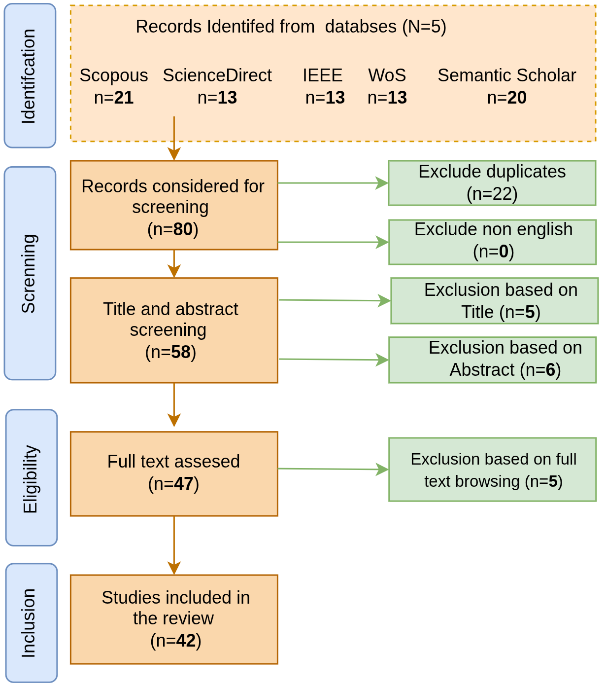

# From Federated Learning to Personalized Intelligence: A Systematic Review of Human-Centric Smart Buildings

`#PersonalizedFederatedLearning` `#FederatedLearning` `#SmartBuildings` `#HumanCentricAI` `#OccupantCentric` `#PrivacyPreservingLearning` `#EdgeIntelligence` `#SystematicReview` `#PRISMA`

## Authors

**Sundas Sarwar**, **Makhmoor Fiza Murk**, **Francesco Piccialli**\*

University of Naples Federico II, Department of Mathematics and Applications "R. Caccioppoli",
M.O.D.A.L. (Mathematical mOdelling and Data AnaLysis) research group, Naples, Italy

\* Corresponding author: francesco.piccialli@unina.it

## About this repository

This repository accompanies our systematic review of Federated Learning (FL) and Personalized Federated Learning (PFL) for human-centric smart buildings. It contains the articles retrieved in the initial literature search and the final set of studies selected after screening, to support the transparency and reproducibility of the review.

## Abstract

Personalized Federated Learning (PFL) is emerging as a promising paradigm for human-centric smart buildings, where collaborative intelligence must accommodate diverse occupant preferences, behaviors, building conditions, and resource capabilities while preserving data privacy. Although Federated Learning (FL) enables collaborative model training without centralizing raw data, a single global model may struggle with the statistical, system, and temporal heterogeneity inherent in real-world building environments. PFL addresses this limitation by adapting collaboratively learned knowledge to heterogeneous occupants, buildings, zones, and devices. However, personalization at the building or device level does not necessarily imply human-centric personalization, which requires explicit consideration of occupant preferences, comfort, behavior, feedback, or related human outcomes. This survey systematically analyzes 42 studies and develops an application-oriented taxonomy mapping FL and PFL approaches across five smart-building domains. We examine personalization targets and strategies, datasets, evaluation metrics, and benchmarking protocols, with particular attention to realism, reproducibility, and cross-study comparability. We further analyze how resource-constrained edge and IoT infrastructures affect communication, computation, latency, and practical PFL deployment, as well as the trade-off between personalization and privacy. The analysis identifies persistent challenges related to data scarcity, heterogeneity, cold-start adaptation, scalability, privacy, fairness, and explainability, and reveals an important distinction between occupant-centric personalization and approaches that primarily adapt models to buildings, zones, or devices. Based on these findings, we outline future directions toward data-efficient and continual personalization, resource-efficient edge intelligence, trustworthy privacy-preserving PFL, standardized real-world evaluation, and digital-twin-assisted personalized intelligence. Overall, this survey provides a structured foundation for advancing adaptive, privacy-aware, and genuinely occupant-centric intelligence in future smart buildings.

## Research questions

- **RQ1:** How are existing PFL paradigms and personalization strategies applied across human-centric smart-building applications?
- **RQ2:** Which datasets, experimental settings, and evaluation metrics are used to assess FL and PFL in smart buildings, and what limitations in data realism, reproducibility, and cross-study comparability characterize current evaluation practices?
- **RQ3:** How do resource-constrained edge environments and heterogeneous IoT infrastructures affect the communication, computation, memory, latency, and scalability of PFL deployment in smart buildings?
- **RQ4:** What trade-offs arise between personalization performance and privacy protection in distributed smart-building systems, and how should these trade-offs inform future privacy-preserving PFL research?

## Repository structure

| File | Description |
|---|---|
| `searched_papers.csv` / `searched_papers.xlsx` | All 80 records retrieved from the five databases in the initial literature search (before duplicate removal and screening) |
| `selected_papers.csv` / `selected_papers.xlsx` | The 42 primary studies included in the review after screening and full-text assessment |
| `PRISMA.png` | PRISMA flow diagram of the study-selection process |

Each file lists the serial number, paper title, and publication year. The CSV and XLSX versions contain the same data.

## Methodology

The review follows the PRISMA guidelines.

- **Databases:** Scopus, Web of Science, IEEE Xplore, ScienceDirect, and Semantic Scholar
- **Search date:** June 24, 2026
- **Publication window:** 2017–2026
- **Language:** English only
- **Search fields:** title, abstract, and keywords (where supported by the database)

**Boolean query** (syntax adapted to each database):

```
(("smart building" OR "intelligent building" OR "building energy management")
 AND ("personalized" OR "user-aware" OR "occupant-centric" OR "human-centric")
 AND ("federated learning" OR "personalized federated learning"))
```

### PRISMA flow diagram

<p align="center">
  
</p>

## Application domains

The 42 included studies are grouped into five human-centric smart-building domains:

| Domain | Share of studies |
|---|---|
| Energy Intelligence | 33.3% |
| Thermal Comfort & Indoor Environmental Quality | 23.8% |
| Occupancy & Human Behavior Analytics | 23.8% |
| Edge Intelligence & IoT Infrastructure | 14.3% |
| Privacy-Preserving Personalization | 4.8% |

Research activity has grown markedly since 2023, with most included studies published in 2025 and 2026.

## How to use this repository

- Browse `selected_papers.csv` for the curated list of FL/PFL studies on human-centric smart buildings.
- Use `searched_papers.csv` together with the search query above to replicate, audit, or extend the review.
- Reuse the curated list as a starting point for benchmarking, secondary studies, or related surveys.

